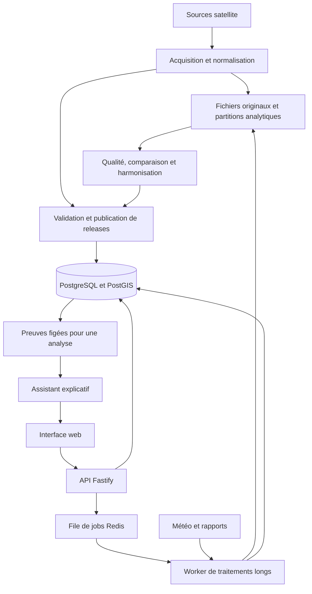
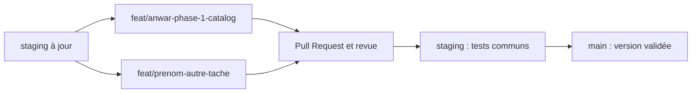

# Comprendre FIREBRIDGE : projet, technologies, état actuel et suite du travail

**Document de référence pour l’équipe — état vérifié le 28 octobre 2026.**

**Lecture après publication de la phase 1 :** les sections d’état ci-dessous conservent l’instantané antérieur à cette livraison. La branche `feat/anwar-phase-1-catalog` contient l’adaptation Fastify, les trois endpoints et leurs tests ; leur présence dans cette branche ne signifie pas qu’ils ont été fusionnés dans `main`. La recette avec les migrations et données réelles reste à effectuer. La démo personnelle a été retirée des fichiers versionnés et reste locale. Les guides à jour sont [Phase 1](PHASE_1.md) et [Construction des endpoints pas à pas](PHASE_1_PAS_A_PAS.md).

Dépôt : [Nasa-hackathon-FIREBRIDGE/firebridge-project](https://github.com/Nasa-hackathon-FIREBRIDGE/firebridge-project).

Ce document explique le produit à construire et ce qui existe réellement. Il distingue trois états : la conception décrite dans les documents, le code publié sur GitHub et les modifications encore locales sur la branche d’Anwar. Les informations sur GitHub ont été vérifiées après un `git fetch origin`.

## 1. Le projet en quelques phrases

FIREBRIDGE est votre projet pour le challenge NASA Space Apps **« Harmonization of MODIS and VIIRS Hot Spots »**.

L’objectif est de rendre les observations de points chauds MODIS et VIIRS plus faciles à explorer et à comparer, puis de produire une mesure harmonisée lorsque les données et la validation scientifique le permettent.

L’utilisateur choisira une zone et une période. L’application présentera les détections, leur origine, les périodes disponibles et, plus tard, des résultats comparables entre sources. La météo et les rapports datés apporteront du contexte. Un assistant pourra expliquer les résultats à partir de preuves enregistrées.

La première livraison utile sera une application descriptive fondée sur de vraies détections. L’harmonisation scientifique sera ajoutée après validation de ses prérequis. Une carte avec deux couches de points ne suffit pas à prouver une harmonisation.

## 2. Pourquoi comparer MODIS et VIIRS demande du travail

MODIS et VIIRS sont des instruments d’observation. Les documents du projet distinguent notamment MODIS sur Terra/Aqua et VIIRS sur S-NPP/NOAA-20/NOAA-21. Chaque produit doit être identifié précisément : plateforme, instrument, collection, version et flux de traitement.

Leurs observations ne sont pas directement interchangeables : résolution, horaires de passage, disponibilité, indicateurs de qualité et champs natifs peuvent différer. Il faut conserver ces différences avant de construire une comparaison commune.

**Exemple fictif :** une zone présente 5 détections MODIS et 12 détections VIIRS pendant une période. Cela ne signifie pas automatiquement qu’il y a eu 17 incendies, ni que le second instrument a observé 2,4 fois plus d’activité réelle. Plusieurs détections peuvent appartenir au même événement et les conditions d’observation peuvent différer.

Le travail comporte donc deux niveaux :

| Niveau                           | Résultat attendu                                                                  | Prérequis                                                                                                         |
| -------------------------------- | --------------------------------------------------------------------------------- | ----------------------------------------------------------------------------------------------------------------- |
| Détections natives               | Afficher et compter les enregistrements de chaque source, en gardant leur origine | Données téléchargées, normalisées, dédupliquées et versionnées                                                    |
| Réponse comparable ou harmonisée | Comparer les observations sur un support et avec une définition communs           | Masques, géolocalisation, contrôle qualité, règles de sélection et validation scientifique ; modèle si nécessaire |

La proposition scientifique des documents commence avec une grille de 5 km au Maroc et une comparaison Aqua–S-NPP. Les seuils de rapprochement temporel et de support commun qui y sont évoqués sont des hypothèses à évaluer, pas des performances déjà démontrées.

## 3. Les règles scientifiques à retenir

1. **Une détection n’est pas un incendie unique.** Les écrans et exports doivent parler de détections lorsqu’ils comptent des points.
2. **L’absence de point ne prouve pas l’absence de feu.** Il peut manquer une observation exploitable, un fichier ou une zone de visibilité.
3. **Une valeur inconnue reste `null`.** Elle ne devient pas zéro pour simplifier un graphique.
4. **Un comptage complet du fichier ne prouve pas une couverture satellite complète.** L’ingestion et l’observabilité sont deux notions différentes.
5. **Ajouter des satellites ne doit pas gonfler artificiellement l’indicateur commun.** Les observations comparables nécessitent une règle de sélection explicite.
6. **Les versions doivent rester reproductibles.** Les résultats d’une analyse doivent continuer à correspondre aux mêmes entrées après une mise à jour.
7. **La météo et les articles apportent du contexte.** Ils ne deviennent pas automatiquement une vérité terrain pour entraîner le modèle.
8. **L’assistant explique les résultats calculés.** Il ne remplace ni les traitements de données ni l’évaluation scientifique.

Le modèle d’harmonisation et l’assistant qui rédige une explication sont deux composants différents.

## 4. Ce que l’utilisateur pourra faire

Voici le parcours cible ; il décrit le futur produit, pas une interface déjà livrée dans ce dépôt.

1. Ouvrir une carte et sélectionner une zone existante ou dessiner un polygone.
2. Choisir une période et consulter les sources disponibles.
3. Lancer une analyse qui conserve les versions exactes des données choisies.
4. Voir les détections natives sur la carte et leur évolution dans le temps.
5. Consulter les données manquantes, leur provenance et les limites de l’analyse.
6. Accéder aux résultats harmonisés lorsque cette zone, cette période et ces produits sont validés.
7. Consulter le contexte météo et les rapports collectés, lorsque ces composants sont prêts.
8. Demander une explication et exporter les résultats avec leurs versions et leurs preuves.

Un composant indisponible doit apparaître comme tel. Une météo manquante ne doit pas empêcher de consulter une analyse satellite déjà disponible.

## 5. Comment les parties du système se connecteront



**L’API** répond aux demandes rapides : catalogue, statut, métadonnées et résultats préparés. **Le worker** réalise les tâches longues : acquisition, transformation, agrégation et export. **La base** relie les données, conserve les versions et sert les résultats utiles à l’application.

Il s’agit d’un backend modulaire, avec plusieurs processus si nécessaire. Le dépôt ne contient pas déjà une application complète de microservices.

## 6. Où seront stockées les données

| Stockage                                             | Ce qu’il contient                                                                                           | Pourquoi                                                                    |
| ---------------------------------------------------- | ----------------------------------------------------------------------------------------------------------- | --------------------------------------------------------------------------- |
| Fichiers originaux et stockage d’objets              | Réponses fournisseurs, CSV, HDF/netCDF, fichiers de preuve                                                  | Conserver les entrées exactes et leurs empreintes                           |
| Parquet/GeoParquet et autres artefacts scientifiques | Archives volumineuses, partitions normalisées, caractéristiques et sorties scientifiques                    | Traiter les gros volumes sans tout charger dans l’API ou la base de service |
| PostgreSQL/PostGIS                                   | Catalogue, géographies, inventaires, versions, membres des releases, analyses, jobs et résultats de service | Requêtes relationnelles et géographiques cohérentes                         |
| Redis                                                | Transport des jobs et éventuellement cache temporaire                                                       | Découpler les requêtes HTTP des traitements longs                           |

Les archives mondiales ne doivent pas être chargées en entier dans la mémoire du serveur HTTP. Les documents proposent de garder les grands volumes dans les fichiers analytiques et de charger des périmètres de service bornés en base.

La conception prévoit que les jobs importants restent enregistrés durablement dans PostgreSQL. Le seul contenu de Redis ne doit pas être la preuve qu’un traitement existe ou a réussi. Ce mécanisme durable reste à implémenter.

## 7. Comprendre les versions de données

| Terme       | Explication simple                                                            |
| ----------- | ----------------------------------------------------------------------------- |
| `source`    | Un produit précis avec sa plateforme, collection et son flux                  |
| `asset`     | Un fichier ou une réponse d’entrée conservé avec son empreinte                |
| `partition` | Un lot de données immuable correspondant à un périmètre déclaré               |
| `release`   | Une version publiée qui référence précisément ses fichiers et partitions      |
| `alias`     | Un nom qui pointe vers la version courante, par exemple `latest_standard`     |
| `scope_key` | L’identifiant d’un périmètre d’inventaire, par exemple `morocco`              |
| `analysis`  | Une sélection utilisateur qui conserve les versions exactes de ses composants |

**Exemple fictif :** `latest_standard` pointe vers la release R1. Une analyse A est créée et conserve R1. Une ingestion publie ensuite R2 et déplace l’alias vers R2. L’analyse A garde R1 ; elle ne change pas silencieusement. Le frontend peut proposer une nouvelle analyse basée sur R2.

Une release peut référencer des partitions historiques réutilisées et des partitions nouvelles. Elle n’a pas besoin de recopier tous les fichiers inchangés.

Les documents distinguent aussi les données standard historiques et les données récentes provisoires. Une correction du fournisseur ou un remplacement du provisoire par du standard peut changer le contenu d’une version, même si le nombre total de lignes reste identique.

## 8. Technologies : ce qui existe et ce qui est prévu

| Technologie                                 | Rôle                                                                    | État réel                                                                                                  |
| ------------------------------------------- | ----------------------------------------------------------------------- | ---------------------------------------------------------------------------------------------------------- |
| Node.js et TypeScript                       | Exécution et langage du backend                                         | Présents dans le dépôt publié                                                                              |
| npm workspaces                              | Organiser les applications et packages du même dépôt                    | Configurés sur GitHub                                                                                      |
| Express                                     | Framework HTTP du socle initial du collègue                             | Encore utilisé dans le code actuellement publié                                                            |
| Fastify                                     | Framework HTTP choisi par l’équipe                                      | Adaptation effectuée localement sur la branche d’Anwar ; pas encore poussée                                |
| PostgreSQL et PostGIS                       | Base relationnelle et traitement géographique                           | Services configurés dans Docker Compose ; base réellement créée/migrée chez le collègue non vérifiable ici |
| Prisma                                      | Outil de modélisation et de migrations présent dans le socle            | Dépendances et configuration présentes ; modèle métier non intégré, aucun historique de migrations publié  |
| `pg`                                        | Requêtes PostgreSQL paramétrées                                         | Utilisé localement par les trois endpoints, en attendant le raccordement aux migrations de l’équipe        |
| Redis                                       | Infrastructure de file de jobs                                          | Service configuré dans Docker Compose                                                                      |
| BullMQ                                      | Traitements asynchrones côté Node.js                                    | Dépendance prévue dans le worker ; pas de consommateur de jobs métier implémenté dans le socle publié      |
| Zod                                         | Validation des variables de configuration                               | Présent dans le socle                                                                                      |
| Pino                                        | Journaux applicatifs                                                    | Présent dans le socle                                                                                      |
| OpenAPI et Swagger                          | Décrire et explorer les routes HTTP                                     | Infrastructure présente initialement, adaptée localement à Fastify                                         |
| Vitest                                      | Tests automatisés du backend                                            | Présent ; tests étendus localement pour la phase 1                                                         |
| PGlite                                      | PostgreSQL embarqué pour tester les requêtes de métadonnées             | Utilisé localement dans les tests de phase 1, avec des données fictives isolées                            |
| ESLint et Prettier                          | Contrôles et formatage du code                                          | Configurés dans le dépôt publié                                                                            |
| Docker et Docker Compose                    | Décrire les environnements API, worker, PostgreSQL et Redis             | Fichiers présents ; leur présence ne prouve pas que les services tournent                                  |
| GitHub Actions                              | Exécuter les vérifications à chaque contribution                        | Workflow ajouté localement ; pas encore disponible sur GitHub                                              |
| React, Vite et TypeScript                   | Interface web proposée                                                  | Mentionnés dans les documents ; aucun frontend dans ce dépôt publié                                        |
| MapLibre, ECharts, TanStack Query, Tailwind | Carte, graphiques, accès aux données et interface proposés              | Choix de conception à confirmer avec le frontend ; pas installés ici                                       |
| Python et outils de données/science         | Décodage des produits, traitements géographiques, évaluation et modèles | Besoin décrit dans les documents ; pipelines exécutables non présents dans ce dépôt publié                 |
| Parquet et DuckDB                           | Stockage analytique et traitement des grands volumes proposés           | Décrits dans les documents ; intégration à construire                                                      |
| Météo historique, rapports et assistant IA  | Contextualisation et explication                                        | Fonctionnalités futures ; adaptateurs non implémentés dans ce dépôt                                        |

### Pourquoi les documents ne citent-ils pas tous les mêmes frameworks ?

Le document `documents/README.md` du 18 octobre propose une architecture Python avec FastAPI, SQLAlchemy et Celery. Le socle publié est ensuite parti sur TypeScript avec Express, Prisma et BullMQ. L’équipe a maintenant choisi Fastify pour l’API.

Ce sont des étapes de conception différentes. Il faut conserver un choix partagé pour chaque responsabilité, au lieu d’implémenter simultanément tous les frameworks mentionnés. Le choix Fastify remplace le serveur Express du socle ; cela ne supprime pas le besoin d’outils scientifiques adaptés aux données satellite.

Le mode d’exécution de futurs traitements Python depuis l’infrastructure de jobs Node.js reste à définir avec la personne chargée des données. L’outil qui gérera les migrations métier doit également être confirmé. Le code local utilisant `pg` n’est pas une décision définitive sur l’ORM de tout le projet.

## 9. Ce que ton collègue a effectivement livré sur GitHub

La vérification montre un seul commit sur `main` : **`776ce6c` — `initial project FIREBRIDGE`**. Les éléments ci-dessous décrivent le contenu de ce commit. Ils ne permettent pas de connaître les travaux non poussés sur le PC de ton collègue.

| Livrable publié                  | Ce qu’il apporte                                                                        | Ce qu’il reste à construire                                                                               |
| -------------------------------- | --------------------------------------------------------------------------------------- | --------------------------------------------------------------------------------------------------------- |
| Monorepo TypeScript              | Une organisation commune, des workspaces et des configurations                          | Les fonctionnalités métier dans chaque module                                                             |
| API Express                      | Démarrage du serveur, middlewares, routes versionnées et contrôleurs                    | Passage à Fastify, accès métier à la base et véritables réponses                                          |
| Routes par ressource             | Emplacements pour catalogue, analyses, détections, météo, exports, administration, etc. | Respecter les contrats du PDF et implémenter leur logique                                                 |
| Routes de santé                  | Une route de vivacité et une route de readiness                                         | La readiness publiée utilise des statuts fixes ; elle ne teste pas réellement la base, Redis ou le worker |
| Configuration de l’environnement | Variables et validation de configuration                                                | Paramètres réels de chaque environnement                                                                  |
| Logs et documentation HTTP       | Base pour diagnostiquer et documenter le serveur                                        | Journalisation et contrat détaillés des fonctionnalités livrées                                           |
| Application worker               | Point d’entrée et message de démarrage                                                  | Consommateurs BullMQ, traitements, reprise, progression et publication                                    |
| Docker Compose                   | Description de PostgreSQL/PostGIS, Redis, API et worker                                 | Appliquer les migrations, charger les données et vérifier le fonctionnement réel                          |
| Squelette Prisma                 | Configuration et modèle `HealthCheck`                                                   | Modèles métier et migrations versionnées                                                                  |
| Schéma SQL de conception         | Proposition de 47 tables et de leurs relations                                          | Historique de migrations et recette sur une vraie base                                                    |
| Tests initiaux                   | Un test API de vivacité et un test du statut de démarrage du worker                     | Tests des endpoints métier, des traitements et du parcours complet                                        |
| Packages partagés                | Emplacements pour le domaine, les contrats, les intégrations et l’observabilité         | Les implémentations, encore largement remplacées par des déclarations `scaffolded`                        |

Le socle est une base de collaboration : il donne une place aux prochaines fonctionnalités et des commandes communes. Il ne constitue pas encore l’application NASA complète.

### Un fichier de route n’est pas une fonctionnalité terminée

Dans le commit publié, les contrôleurs métier renvoient principalement `501`, avec un message indiquant que la fonctionnalité est prévue. Cela signifie que la route existe, mais que son traitement n’est pas implémenté.

Le catalogue initial liste **34 routes réparties en 17 groupes de ressources**. Le PDF de l’équipe définit **30 routes réparties en 7 phases**. Ce sont deux inventaires différents : les routes génériques du squelette devront être alignées sur les contrats par phase. Le nombre de fichiers ou de routes ne représente pas un nombre de fonctionnalités terminées.

### Sources GitHub qui prouvent cet état

Ces liens pointent sur le commit vérifié, pour ne pas confondre le code initial avec les futures mises à jour :

- [Serveur Express initial](https://github.com/Nasa-hackathon-FIREBRIDGE/firebridge-project/blob/776ce6c/apps/api/src/app.ts).
- [Contrôleur catalogue encore en 501](https://github.com/Nasa-hackathon-FIREBRIDGE/firebridge-project/blob/776ce6c/apps/api/src/controllers/catalog.controller.ts).
- [Readiness avec valeurs fixes](https://github.com/Nasa-hackathon-FIREBRIDGE/firebridge-project/blob/776ce6c/apps/api/src/services/health.service.ts).
- [Point d’entrée du worker](https://github.com/Nasa-hackathon-FIREBRIDGE/firebridge-project/blob/776ce6c/apps/worker/src/worker.ts).
- [Modèle Prisma limité à HealthCheck](https://github.com/Nasa-hackathon-FIREBRIDGE/firebridge-project/blob/776ce6c/packages/database/prisma/schema.prisma).
- [Schéma SQL de conception](https://github.com/Nasa-hackathon-FIREBRIDGE/firebridge-project/blob/776ce6c/packages/database/prisma/sql/firebridge_schema_v2.sql).
- [Configuration Docker Compose](https://github.com/Nasa-hackathon-FIREBRIDGE/firebridge-project/blob/776ce6c/docker-compose.yml).
- [Catalogue initial des routes](https://github.com/Nasa-hackathon-FIREBRIDGE/firebridge-project/blob/776ce6c/endpoint_catalog.json).

## 10. La base Docker et les migrations : où en sommes-nous ?

**Sur GitHub, aucune migration métier versionnée n’est présente au moment de cette vérification.** Le dossier `packages/database/prisma/migrations` n’apparaît pas dans l’arbre publié. Le fichier `schema.prisma` ne modélise que `HealthCheck`.

Le fichier SQL des 47 tables est explicitement présenté comme un artefact de conception. Dans le Docker Compose publié, il n’est pas monté comme script d’initialisation et aucune commande de migration métier n’est définie. Démarrer le conteneur ne suffit donc pas à démontrer que ces tables ont été créées.

Il faut distinguer trois choses :

| Élément                                                  | Partagé par Git ?                        | Effet                                                                                             |
| -------------------------------------------------------- | ---------------------------------------- | ------------------------------------------------------------------------------------------------- |
| `docker-compose.yml`                                     | Oui                                      | Décrit comment démarrer les services                                                              |
| Fichiers de migration et éventuels scripts d’import/seed | Oui, lorsqu’ils sont commités et poussés | Permettent à chacun de construire le même schéma et, si prévu, un jeu de données de développement |
| Contenu du volume PostgreSQL sur le PC d’un membre       | Non, pas par un `git push` ordinaire     | Contient les tables et données de sa propre instance                                              |

Ton collègue peut avoir une base fonctionnelle ou des migrations sur son PC. Cet état n’est pas vérifiable à partir du dépôt tant qu’il n’a pas partagé les fichiers correspondants. Une base distante commune est également possible, mais aucune instance accessible n’a été établie pendant cette analyse.

**Les éléments à coordonner avec lui sont :** l’outil de migration choisi, les fichiers à exécuter, la commande officielle, le schéma SQL de référence, les noms de tables et les données de développement disponibles. Des secrets ou un volume de données complet ne doivent pas être nécessaires pour simplement relire les migrations.

## 11. État des branches et du travail local d’Anwar

Au moment de la vérification :

| Emplacement                                | État                                                                                  |
| ------------------------------------------ | ------------------------------------------------------------------------------------- |
| `origin/main`                              | Commit `776ce6c`, socle initial                                                       |
| `origin/feat/anwar-phase-1-catalog`        | Même commit `776ce6c` ; branche créée sur GitHub mais code local non poussé           |
| `staging` sur GitHub                       | Aucune branche `staging` observée                                                     |
| Branche locale courante                    | `feat/anwar-phase-1-catalog`, avec des modifications non commitées                    |
| Dossier `documents/`                       | Documents fournis par Anwar, présents localement mais non suivis par Git à cette date |
| Dossier `docs/` et workflow GitHub Actions | Ajouts locaux, pas encore publiés                                                     |

### Ce qui est déjà implémenté localement

- Adaptation du serveur et des routes existantes à Fastify.
- Lecture du catalogue par scope, avec séparation entre disponibilité fournisseur et inventaire local.
- Consultation d’une release publiée avec pagination signée des partitions ou des fichiers.
- Vérification des mises à jour par UUID, avec prise en compte des changements intermédiaires.
- Validation des paramètres, enveloppes de réponse, erreurs explicites et exclusion des chemins privés.
- Transactions PostgreSQL en lecture seule, avec une vue cohérente pendant la requête.
- Readiness fondée sur la disponibilité réelle du catalogue.
- Documentation de la phase 1 et workflow de vérification pour GitHub Actions.

La dernière validation locale a réussi : **23 tests API et 1 test worker, build TypeScript et lint**. Les tests utilisent PostgreSQL embarqué avec des données fictives isolées. Les types PostGIS y sont remplacés pour tester les métadonnées ; ils ne constituent pas une validation de l’installation PostGIS ou du traitement spatial réel.

Docker Desktop ne fournissait pas de moteur démarré lors de la vérification locale. Le démarrage des conteneurs et la recette avec les futures migrations et de vraies données restent donc à faire.

**Ces modifications locales ne sont pas encore une livraison GitHub.** Il faut les relire, les commiter puis les pousser sur la branche d’Anwar. Le présent document est lui aussi local tant qu’il n’est pas publié.

## 12. Les phases du backend à développer

Le découpage ci-dessous suit le PDF de l’équipe. Tous les chemins sont relatifs à `/api/v1`. Il décrit le périmètre cible ; les phases ne sont pas toutes déjà implémentées.

| Phase                                     | Routes cibles                                                                                                                                                                                                                            | Livrable attendu                                                               |
| ----------------------------------------- | ---------------------------------------------------------------------------------------------------------------------------------------------------------------------------------------------------------------------------------------- | ------------------------------------------------------------------------------ |
| 0 — Socle                                 | `GET /health/live` ; `GET /health/ready`                                                                                                                                                                                                 | Serveur, validation et conventions communes ; santé réellement vérifiée        |
| 1 — Catalogue et versions                 | `GET /catalog` ; `GET /releases/{release_id}` ; `GET /updates`                                                                                                                                                                           | Choisir les produits et connaître les versions disponibles                     |
| 2 — Zone vers analyse                     | `POST /areas` ; `GET /areas/{area_id}` ; `POST /analyses` ; `GET /analyses/{id}` ; `GET /jobs/{id}`                                                                                                                                      | Enregistrer une zone, créer une analyse reproductible et suivre sa préparation |
| 3 — Résultats natifs                      | `GET /analyses/{id}/detections` ; `GET /analyses/{id}/summary` ; `GET /analyses/{id}/calendar` ; `GET /analyses/{id}/provenance`                                                                                                         | Carte et indicateurs descriptifs avec preuves et données manquantes explicites |
| 4 — Carte et exports                      | `GET /analyses/{id}/tiles/{layer}/{z}/{x}/{y}.mvt` ; `POST /analyses/{id}/exports` ; `GET /jobs/{id}/download`                                                                                                                           | Affichage à grande échelle et téléchargement préparé                           |
| 5 — Ingestion et opérations               | `GET /admin/ingestion/subscriptions` ; `POST /admin/ingestion/backfills` ; `GET /admin/ingestion/runs/{id}` ; `GET /admin/ingestion/gaps` ; `POST /admin/ingestion/subscriptions/{id}/refresh` ; `GET /sources/{source_id}/availability` | Alimenter, surveiller, réparer et publier les données ; avance en parallèle    |
| 6 — Dépendances scientifiques et contexte | `GET /analyses/{id}/coverage` ; `GET /analyses/{id}/cells/{cell_id}` ; `GET /analyses/{id}/comparison` ; `GET /analyses/{id}/weather` ; `GET /analyses/{id}/reports` ; `POST /analyses/{id}/explanations` ; `GET /explanations/{id}`     | Couverture, comparaison validée, météo, rapports et explication                |

Les phases comptent respectivement **2 + 3 + 5 + 4 + 3 + 6 + 7 = 30 routes**. La numérotation des endpoints du PDF diffère de celle de `documents/API.md`, car le PDF ajoute les deux routes de santé et regroupe les tâches par phase.

Le chemin prioritaire proposé est : socle, catalogue, création d’analyses, résultats natifs. L’ingestion doit avancer en parallèle pour fournir de vraies données. Les tuiles et exports suivent les premiers résultats. Les fonctions exigeant masques, modèles ou contexte attendent leurs prérequis.

## 13. Ta phase 1 et son rôle dans tout le projet

Anwar possède pour l’instant la phase 1, soit trois endpoints cohérents. Les phases suivantes ne lui sont pas encore attribuées : elles devront être choisies avec l’équipe.

| Endpoint                     | Question à laquelle il répond                                      | Exemple de besoin frontend                                                |
| ---------------------------- | ------------------------------------------------------------------ | ------------------------------------------------------------------------- |
| `GET /catalog`               | Quelles sources, métriques et versions puis-je sélectionner ?      | Remplir les sélecteurs de l’interface                                     |
| `GET /releases/{release_id}` | Que contient exactement cette version ?                            | Afficher les détails de la version et sa provenance                       |
| `GET /updates`               | Les aliases que je surveille pointent-ils vers une autre version ? | Afficher une proposition d’actualisation sans changer l’analyse existante |

Ces endpoints dépendent de tables alimentées par la publication des données. Leur code peut être développé et testé avant la livraison de l’ingestion, mais une démonstration avec de vrais résultats nécessite une release effectivement publiée.

Le [guide technique de phase 1](PHASE_1.md) décrit les requêtes, les erreurs, la pagination et les conventions JSON à partager avec le membre chargé de l’ingestion. Le [contrat HTTP local](../API.md) donne les paramètres et réponses détaillés.

## 14. Les prochaines livraisons concrètes à organiser

Cette liste est un ordre de coordination proposé, pas une nouvelle répartition imposée à l’équipe.

| Étape                                  | Résultat vérifiable                                                                                               |
| -------------------------------------- | ----------------------------------------------------------------------------------------------------------------- |
| Partager les migrations de la base     | Un autre membre peut créer le même schéma sur une base vide avec une commande documentée                          |
| Confirmer le contrat entre base et API | Les tables, statuts, scopes et métadonnées de publication correspondent aux requêtes des endpoints                |
| Livrer la phase 1                      | Code relu et poussé ; tests réussis ; catalogue servi depuis une release connue                                   |
| Publier un premier petit jeu réel      | Entrées conservées, produits identifiés, partitions et alias publiés, provenance consultable                      |
| Livrer zone → analyse → statut         | Une sélection valide produit une analyse qui conserve ses versions et un statut fiable                            |
| Livrer les résultats natifs            | Détections, résumé et calendrier correspondent au même jeu publié et expliquent les inconnues                     |
| Brancher une première interface        | Un utilisateur peut sélectionner une zone et explorer les résultats sans téléchargement incontrôlé                |
| Renforcer les opérations               | Réessais, données tardives, corrections, gaps et export n’altèrent pas les anciennes analyses                     |
| Valider l’harmonisation                | Les jeux de masques/géolocalisation, les comparaisons et l’évaluation permettent de justifier l’indicateur commun |
| Ajouter le contexte et l’explication   | Météo, rapports et explication réutilisent les versions et preuves de l’analyse                                   |

Les fonctions de base doivent rester démontrables même si l’harmonisation ou un fournisseur de contexte n’est pas encore disponible. L’état scientifique doit être annoncé honnêtement dans l’interface et la présentation du challenge.

## 15. Comment travailler avec les branches

Une branche correspond à une tâche cohérente qu’on peut relire et tester. Elle n’est créée ni à chaque fichier modifié, ni à chaque push.



Ce schéma décrit le fonctionnement à mettre en place ; `staging` n’a pas encore été observée sur GitHub. La branche actuelle d’Anwar a été créée depuis `main`, ce qui convient tant que `staging` n’existe pas encore et partira du même socle.

Le cycle d’une tâche est : créer la branche, développer, faire des commits cohérents, pousser, ouvrir une Pull Request vers `staging`, faire relire, tester et fusionner. Pour une nouvelle tâche, on repart d’une `staging` à jour dans une nouvelle branche.

| Terme Git    | Ce qu’il fait                                                               |
| ------------ | --------------------------------------------------------------------------- |
| Branche      | Isole une ligne de travail                                                  |
| Commit       | Enregistre un ensemble de changements dans l’historique local               |
| Push         | Envoie les commits et la référence de branche sur GitHub                    |
| Fetch        | Récupère les références et commits distants sans fusionner dans ton travail |
| Pull Request | Propose et permet de relire une fusion sur GitHub                           |
| Merge        | Intègre l’historique d’une branche dans une autre                           |

Après la fusion d’une tâche dans `staging`, un membre qui travaille déjà sur une autre branche peut y intégrer les nouveautés :

```bash
git fetch origin
git switch nom-de-sa-branche
git merge origin/staging
```

Ces commandes supposent que `staging` existe déjà et que le travail local est dans un état approprié pour la fusion. `git pull` sur sa propre branche ne récupère pas automatiquement les contributions d’une autre branche.

Un endpoint devient une livraison relisible quand son comportement est documenté, ses données sont identifiées, ses tests appropriés passent et son code est poussé dans une branche de Pull Request. La fusion vers `main` suit les tests communs et la validation de l’équipe.

## 16. Ce qui reste à confirmer avec les autres membres

- Les migrations et la commande officielle pour les appliquer ; l’état actuel de la base du membre qui en est responsable.
- Les premières sources réellement acquises, le scope de démonstration et le stockage des fichiers volumineux.
- Le contrat de publication : configuration, digests, membres des releases et aliases.
- La prochaine tâche de chaque membre après ses endpoints actuels.
- Le frontend et les choix d’interface retenus parmi les propositions des documents.
- Le fonctionnement des traitements scientifiques et leur raccordement aux jobs.
- Les prérequis et preuves d’évaluation qui permettront d’annoncer une harmonisation validée.
- Les règles de revue, les vérifications obligatoires et la création de `staging`.

Cette liste permet de coordonner les interfaces entre tâches ; elle n’oblige pas à attendre toutes les réponses pour continuer le développement indépendant.

## 17. Documents consultés et limites de cette analyse

| Source locale                                             | Rôle dans cette explication                                                              |
| --------------------------------------------------------- | ---------------------------------------------------------------------------------------- |
| `documents/README.md`                                     | Vision initiale du produit et des règles scientifiques ; document du 18 octobre          |
| `documents/DATA_PLATFORM.md`                              | Conception v2 de la plateforme, des inventaires et des versions ; document du 24 octobre |
| `documents/API.md`                                        | Contrats détaillés des endpoints                                                         |
| `documents/schema.sql`                                    | Schéma de conception des 47 tables                                                       |
| `documents/FIREBRIDGE_endpoints_par_phase213.pdf`         | Découpage des 30 routes en phases                                                        |
| Arbre et fichiers de `origin/main` au commit `776ce6c`    | Preuve de ce qui est réellement publié dans ce dépôt                                     |
| Modifications de travail sur `feat/anwar-phase-1-catalog` | État de l’implémentation locale de phase 1                                               |

Le README initial parle d’un schéma de 28 tables ; la conception v2 et le SQL présents en définissent 47. Pour le travail actuel, la v2 est la référence de conception la plus récente parmi les fichiers fournis.

Les documents mentionnent également des scripts d’acquisition, des analyses MODIS, des jeux Parquet, des rapports et des volumes d’archives. Ces ressources ne sont pas présentes dans l’arbre GitHub vérifié ici. Leur existence ailleurs est possible, mais leurs résultats, leur disponibilité et leur état d’avancement ne sont pas confirmés par cette vérification du backend.

Des fichiers référencés, notamment `DATABASE.md`, `PIPELINES.md`, `SOURCES.md` et `validation.json`, ne figurent pas dans le dossier `documents/` fourni. Les parties manquantes devront être partagées si elles existent.

Ce document décrit un instantané. Après la publication de nouvelles migrations, d’un frontend ou des commits de phase 1, la section d’état devra être actualisée depuis les références GitHub, plutôt que déduite de l’avancement local d’un membre.
