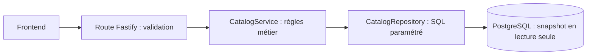

# Phase 1 — Catalogue et versions de données

Pour comprendre comment le code a été construit, suivre le [guide pas à pas Fastify et endpoints](PHASE_1_PAS_A_PAS.md) : démarrage du serveur, validation, service, SQL, réponses et tests de chacun des trois endpoints.

## Ce que cette phase apporte

Le frontend a besoin de savoir quelles sources et métriques sont disponibles, puis de choisir une version précise des données. Il peut ensuite vérifier si cette version a changé. Les trois endpoints servent ces informations depuis PostgreSQL ; ils ne téléchargent rien chez NASA et ne déclenchent pas de calcul scientifique.

Le découpage des phases suit `documents/FIREBRIDGE_endpoints_par_phase213.pdf`. Le détail métier vient de `documents/API.md` et de `documents/DATA_PLATFORM.md`. Certains anciens documents proposent FastAPI/Python : le choix d’équipe utilisé ici est Fastify/TypeScript.

## Les mots du projet

| Terme     | Sens                                                                        |
| --------- | --------------------------------------------------------------------------- |
| Source    | Un produit précis, une plateforme, une collection et un flux de traitement  |
| Asset     | Un fichier ou une réponse fournisseur conservé avec son empreinte           |
| Partition | Un lot immuable de données, avec sa période et son périmètre                |
| Release   | Une version publiée qui référence exactement ses partitions et ses fichiers |
| Alias     | Un nom comme `latest_standard` qui pointe vers la release courante          |
| Scope     | Le périmètre enregistré de l’inventaire, par exemple `morocco`              |
| Métrique  | La définition de ce qui est mesuré, avec son unité et ses prérequis         |

Une nouvelle ingestion crée une nouvelle release, puis déplace l’alias dans une transaction de publication. Elle ne modifie pas une ancienne release. Une analyse pourra donc conserver son ancien UUID et rester reproductible.

## Le parcours d’une requête



Les routes sont dans `apps/api/src/routes/`. Le service est dans `apps/api/src/services/catalog.service.ts`. Les requêtes sont dans `apps/api/src/repositories/catalog.repository.ts`. `database.ts` ouvre une transaction `REPEATABLE READ READ ONLY` par requête afin que les informations restent cohérentes si un alias change pendant la lecture.

Les autres routes existantes ont aussi été adaptées aux types Fastify pour conserver une seule application HTTP. Leur logique métier reste à implémenter et leurs réponses restent `501`.

## 1. Catalogue

`GET /api/v1/catalog?scope_key=morocco`

Le frontend reçoit les sources du scope, leur disponibilité fournisseur, les intervalles présents dans les partitions validées des releases courantes, les métriques explicitement publiées, leurs grilles, les aliases et les limites de requêtes.

Les releases courantes sont celles visées par les aliases publiés de ce scope. Une ancienne release reste accessible par son UUID via `/releases/{release_id}`.

La disponibilité fournisseur provient de la dernière vérification de chaque feed vérifié associé au scope. Un feed non vérifié reste `unknown`. Une date fournisseur ne prouve pas que FIREBRIDGE a téléchargé cette période.

Les intervalles détaillés restent séparés : on ne transforme pas des périodes disjointes en une couverture continue. Le champ singulier `ingested_interval` reste `null` lorsqu’il y a plusieurs intervalles. `serving_complete` indique si la partition est entièrement présente dans les tables de service. Cela ne mesure pas la couverture nuageuse ou l’observabilité locale du satellite.

## 2. Version exacte

`GET /api/v1/releases/{release_id}`

Le frontend peut inspecter une release publiée : version du code, digests, date de publication, parent, composition des sources, nombres de partitions et journal des changements.

Les membres sont paginés avec `membership=partitions|assets`, `limit` de 1 à 100 et `cursor`. Le curseur signé est lié à la release, au type de membres et à la taille de page. Pour continuer, il faut renvoyer le curseur avec les mêmes paramètres. Un curseur altéré ou réutilisé pour une autre sélection est rejeté.

Les nombres potentiellement volumineux, comme `row_count` et `byte_size`, sont des chaînes décimales pour conserver la précision des entiers PostgreSQL.

Le rôle `record` désigne les sources des enregistrements normalisés. Le rôle `input` désigne les sources des fichiers d’entrée. Ces rôles restent distincts, notamment pour un fichier MODIS contenant plusieurs plateformes.

Les chemins de stockage, URLs privées et configurations brutes ne sont pas renvoyés. L’ETag dépend de la représentation de la page ; `If-None-Match` permet une réponse `304` si elle est identique.

## 3. Mises à jour

`GET /api/v1/updates?scope_key=morocco&alias=latest_standard&after_release_id={release_id}`

Le frontend envoie l’UUID qu’il connaît. L’API le compare aux UUIDs des aliases sélectionnés. Un nombre identique de détections ne signifie pas que la version est identique : des corrections peuvent retirer et ajouter des lignes.

Sans `after_release_id`, la réponse fournit les versions courantes avec `comparison=baseline_not_provided` et `has_updates=false` : aucune comparaison n’a encore été demandée.

Avec un UUID, le composant est limité par défaut au type de dataset de cette release. Le filtre `alias` permet de surveiller un flux précis ; sans ce filtre, toute différence dans les aliases du composant sélectionné peut produire `has_updates=true`.

L’API suit les parents pour résumer les changements intermédiaires. Si la release de départ n’est pas un ancêtre de la version courante, elle renvoie `history_complete=false` et l’avertissement `BASELINE_NOT_ANCESTOR`. Elle ne prétend pas fournir un historique complet entre deux branches de versions.

Les changements sont regroupés par raison pour borner la réponse. `revision_records` compte les entrées du journal, pas des incendies ni des partitions uniques. `affected_interval` est l’enveloppe temporelle de ces entrées ; elle peut contenir des périodes non modifiées.

## Contrat à respecter côté ingestion

Le schéma SQL existe déjà dans `packages/database/prisma/sql/firebridge_schema_v2.sql`. Cette phase précise les clés JSON suivantes pour que l’API puisse servir les informations sans déductions implicites :

Les migrations officielles de la base restent à fournir par le membre qui en est responsable. Les endpoints sont raccordés aux noms de tables de ce schéma de conception ; il faudra vérifier leur compatibilité avec ses migrations avant l’intégration. L’API ne crée ni ne migre la base au démarrage.

### `data_releases.config`

```json
{
  "metric_ids": ["native_detections_v1"],
  "grid_ids": [],
  "manifest_sha256": "empreinte SHA-256 réelle du manifeste : 64 caractères hexadécimaux"
}
```

`metric_ids` et `grid_ids` doivent référencer les registres existants. Une métrique n’est annoncée que si une release courante la déclare. Les grilles d’une autre release ne lui sont pas attribuées. Les prérequis scientifiques et la compatibilité de ces déclarations doivent être vérifiés par les gates de publication du worker. Le digest du manifeste est `null` dans l’API s’il est absent ou mal formé ; l’API ne calcule pas une empreinte à partir d’un chemin privé.

### `data_partitions.support_spec`

```json
{
  "source_ids": ["modis_terra_c61_standard"],
  "start": "2024-01-17T00:00:00Z",
  "end_exclusive": "2024-01-18T00:00:00Z"
}
```

Ces clés décrivent le contenu réel de la partition. Les bornes sont UTC et l’intervalle est semi-ouvert. Sans bornes documentées, l’API conserve l’intervalle inconnu. Les publications doivent remplir les tables de membres, conserver les digests et publier les aliases atomiquement dans le même scope.

La phase 1 ne fournit ni scheduler d’ingestion, ni comptes utilisateurs, ni authentification métier. Elle correspond à une API de consultation des données publiées. Les futures opérations d’administration devront ajouter leur contrôle d’accès.

## Vérifier ton travail

Pour une recette manuelle, démarrer l’API avec la base de développement et une release publiée, puis ouvrir `http://localhost:3000/api-docs/`. Utiliser les paramètres et réponses du [contrat HTTP](../API.md). Les jeux fictifs versionnés sont réservés aux tests automatisés ; une éventuelle démo personnelle reste hors du dépôt.

```bash
npm run lint
npm run build
npm test
```

Les tests couvrent les trois routes, les valeurs inconnues, les scopes, les métriques/grilles, les releases non publiées, les curseurs, les ETags, les corrections intermédiaires, l’absence de mutation et les erreurs de connexion.

Les données de test sont fictives et chargées uniquement dans un PostgreSQL embarqué isolé. Elles ne sont pas chargées dans la base de l’application. La validation de l’installation Docker/PostGIS et une recette avec des données réellement ingérées restent nécessaires avant intégration finale.

## Ton cycle Git pour cette phase

Tout ce travail appartient à `feat/anwar-phase-1-catalog`. Une fois le code et les tests relus :

1. Faire un commit des fichiers de cette tâche.
2. Pousser cette même branche sur GitHub.
3. Ouvrir une Pull Request vers `staging` lorsqu’elle existe.
4. Faire relire et tester avec l’équipe, notamment le contrat d’ingestion ci-dessus.
5. Fusionner dans `staging`, puis repartir de `staging` à jour pour une nouvelle tâche.

La publication initiale de la branche sur GitHub ne contient pas les modifications locales tant qu’elles n’ont pas été commitées et poussées.
