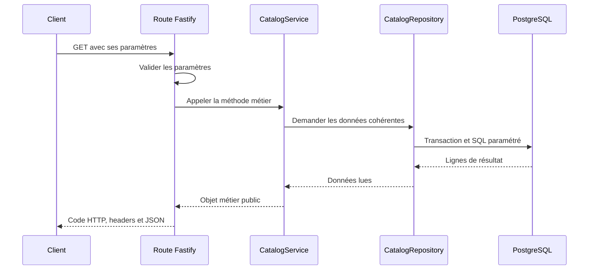

# Phase 1 pas à pas : comment nous avons construit les trois endpoints

Ce guide explique le code local de FIREBRIDGE, depuis le besoin métier jusqu’à la réponse HTTP et aux tests. Il permet de relire ce qui a été fait, puis de suivre une méthode similaire pour une autre tâche.

La version Fastify installée lors de cette vérification est **5.12.7**. Les versions résolues sont enregistrées dans `package-lock.json`. Les extraits ci-dessous montrent le code du projet ou une version explicitement abrégée ; ils ne sont pas des fichiers supplémentaires à copier dans l’application.

## 1. Ce que nous avions au départ

Ton collègue avait préparé un monorepo TypeScript avec une application API Express, des routes et des contrôleurs. Les trois fonctionnalités de notre phase étaient encore des squelettes qui répondaient `501`.

Nous avons conservé l’organisation du dépôt et ses autres ressources. Nous avons adapté le serveur à **Fastify**, conformément au choix de l’équipe, puis implémenté :

| Méthode et chemin final             | Besoin                                                   |
| ----------------------------------- | -------------------------------------------------------- |
| `GET /api/v1/catalog`               | Connaître les sources, métriques et versions disponibles |
| `GET /api/v1/releases/{release_id}` | Inspecter une version publiée précise                    |
| `GET /api/v1/updates`               | Comparer les versions courantes avec une version connue  |

Les trois endpoints sont des lectures. Ils n’ingèrent pas de données NASA et ne créent pas de release.

**Situation à garder en tête :** leur code est local tant qu’il n’a pas été commité puis poussé. Le raccordement aux migrations officielles et une recette avec les données réelles de l’équipe restent nécessaires.

## 2. Qu’est-ce qu’un endpoint ?

Un endpoint est un point d’accès HTTP identifié par une méthode et un chemin, avec des paramètres et une réponse définis.

Prenons :

```http
GET /api/v1/catalog?scope_key=morocco
```

| Partie                            | Signification                                    |
| --------------------------------- | ------------------------------------------------ |
| `GET`                             | Le client demande une lecture                    |
| `/api/v1/catalog`                 | Chemin de la ressource                           |
| `scope_key=morocco`               | Paramètre de query string : le périmètre demandé |
| Code `200`, `404`, `422` ou `503` | Résultat HTTP de la demande                      |
| Corps JSON                        | Les données ou une erreur explicite              |

Pour les trois endpoints de cette phase, nous utilisons des paramètres dans le chemin ou dans la query string. Aucun corps JSON de requête n’est demandé.

## 3. L’ordre logique du travail

Nous avons suivi ce découpage :

1. Lire le PDF des phases et les contrats API pour définir précisément les trois besoins.
2. Examiner le socle existant pour réutiliser sa structure.
3. Adapter l’application HTTP à Fastify.
4. Définir et valider les paramètres de chaque route.
5. Implémenter les règles dans un service.
6. Écrire les requêtes PostgreSQL paramétrées.
7. Construire les réponses communes et les erreurs.
8. Ajouter la pagination et la vérification des mises à jour.
9. Tester les routes avec de vraies requêtes SQL sur une base isolée.
10. Documenter les conventions pour les membres chargés du frontend et de l’ingestion.

Cette séquence explique la construction. À l’exécution, le parcours est plus court :



## 4. Dans quels fichiers avons-nous travaillé ?

Tous les chemins de cette table sont relatifs à `apps/api/` :

| Fichier                                  | Responsabilité                                               |
| ---------------------------------------- | ------------------------------------------------------------ |
| `package.json`                           | Dépendances Fastify/PostgreSQL et commandes de l’application |
| `src/config/env.ts`                      | Charger et valider la configuration                          |
| `src/app.ts`                             | Construire l’application Fastify et brancher ses dépendances |
| `src/server.ts`                          | Démarrer l’écoute réseau et gérer l’arrêt                    |
| `src/routes/index.ts`                    | Enregistrer les groupes de routes avec leurs préfixes        |
| `src/routes/catalog.routes.ts`           | Entrées HTTP et réponse du catalogue                         |
| `src/routes/releases.routes.ts`          | Entrées HTTP, réponse et ETag d’une release                  |
| `src/routes/updates.routes.ts`           | Entrées HTTP et réponse des mises à jour                     |
| `src/routes/phase-one.schemas.ts`        | Schémas communs de validation et de réponse                  |
| `src/services/catalog.service.ts`        | Règles métier des trois endpoints                            |
| `src/repositories/catalog.repository.ts` | Requêtes SQL                                                 |
| `src/repositories/database.ts`           | Connexions et transactions PostgreSQL                        |
| `src/utils/response.ts`                  | Enveloppe JSON et classe `ApiError`                          |
| `src/utils/cursor.ts`                    | Création et vérification des curseurs signés                 |
| `src/middleware/error-handler.ts`        | Transformer les erreurs en réponses HTTP                     |
| `src/types/fastify.d.ts`                 | Déclarer le service ajouté à Fastify pour TypeScript         |
| `tests/app.test.ts`                      | Tester les parcours HTTP                                     |
| `tests/helpers/database.ts`              | Construire la base et les données fictives de test           |

Les trois anciens contrôleurs Express de cette phase ont été retirés. Les routes Fastify appellent directement le service ; un contrôleur intermédiaire n’était pas nécessaire ici. Les autres contrôleurs existants ont été adaptés aux types Fastify et restent des squelettes `501`.

## 5. Installer et configurer le socle Fastify

Le manifeste de l’API remplace les dépendances HTTP Express par les dépendances Fastify. Voici leur rôle dans **notre code** :

| Dépendance            | Utilisation                                                 |
| --------------------- | ----------------------------------------------------------- |
| `fastify`             | Serveur, routes, schémas et cycle de requête                |
| `@fastify/cors`       | Gestion des échanges avec un frontend sur une autre origine |
| `@fastify/helmet`     | Ajout de headers de sécurité HTTP                           |
| `@fastify/compress`   | Compression des réponses                                    |
| `@fastify/swagger`    | Construction du document OpenAPI depuis les routes          |
| `@fastify/swagger-ui` | Interface de consultation du document OpenAPI               |
| `pg`                  | Connexions et requêtes PostgreSQL                           |
| `zod` et `dotenv`     | Configuration de l’environnement                            |

Pour récupérer les versions enregistrées dans le dépôt, on utilisera `npm ci` après publication du lockfile. Il n’est pas nécessaire de réinstaller manuellement chaque package à chaque lancement.

### Configuration et validation HTTP sont deux choses différentes

Dans `src/config/env.ts`, Zod valide au démarrage des variables telles que :

```text
DATABASE_URL
DEFAULT_SCOPE_KEY
CURSOR_SECRET
PORT
```

Une configuration invalide empêche le serveur de démarrer. Cela n’est pas une erreur `422` d’un client : aucune requête HTTP n’est encore en cours.

Les paramètres envoyés par le client sont ensuite validés avec les JSON Schemas des routes Fastify. Nous n’utilisons pas Zod comme validateur de ces routes.

## 6. Construire l’application dans `app.ts`

Voici la création de l’instance, telle qu’elle apparaît dans le projet :

```ts
const app = Fastify({
  logger: options.logger ?? { level: env.LOG_LEVEL },
  genReqId: () => randomUUID(),
  bodyLimit: 1024 * 1024,
  ajv: { customOptions: { removeAdditional: false, coerceTypes: false } }
});
```

`logger` configure les journaux. `genReqId` donne un identifiant à chaque requête. `bodyLimit` borne les corps reçus par le serveur. La configuration AJV conserve une validation stricte : les propriétés supplémentaires sont rejetées lorsque le schéma les interdit, plutôt que supprimées silencieusement, et les types ne sont pas convertis automatiquement.

### Brancher le service avec `decorate`

```ts
const database = options.database ?? createDatabase(env.DATABASE_URL);
app.decorate('catalogService', new CatalogService(new CatalogRepository(database), env));
```

Cette ligne assemble les objets nécessaires : le service reçoit un repository et la configuration ; le repository reçoit l’accès à la base. `decorate` rend le service accessible via `app.catalogService` dans les routes enregistrées sous cette application.

Le fichier `src/types/fastify.d.ts` indique aussi à TypeScript que cette propriété existe :

```ts
declare module 'fastify' {
  interface FastifyInstance {
    catalogService: CatalogService;
  }
}
```

La déclaration de type aide l’éditeur et le compilateur. C’est `decorate`, exécuté au démarrage, qui ajoute réellement la propriété.

Le paramètre optionnel `database` de `createApp` permet de brancher la base isolée dans les tests. Sans ce paramètre, l’application utilise PostgreSQL via `DATABASE_URL`.

### Brancher les plugins et les hooks

```ts
app.register(helmet);
app.register(cors);
app.register(compress);
app.register(swagger, { openapi: { info: { title: 'FIREBRIDGE API', version: '1.0.0' } } });
app.register(swaggerUi, { routePrefix: '/api-docs' });
```

Un plugin est une fonction qui ajoute un ensemble de capacités ou de routes à l’application. Les groupes de routes du projet sont eux-mêmes des plugins. `register` est le mécanisme utilisé pour les assembler. Voir la [documentation officielle des plugins](https://fastify.dev/docs/latest/Reference/Plugins/).

Nous ajoutons également un hook `onRequest` pour renvoyer `X-Request-Id`, et un hook `onClose` pour fermer le pool PostgreSQL lorsque l’application en est propriétaire.

## 7. Séparer la construction du serveur de son lancement

`createApp()` construit l’application et retourne l’instance. `server.ts` la démarre :

```ts
const app = createApp();
await app.listen({ port: env.PORT, host: '0.0.0.0' });
```

Le code complet gère aussi les erreurs de démarrage et les signaux `SIGINT`/`SIGTERM`. L’adresse `0.0.0.0` permet au serveur d’écouter sur les interfaces nécessaires, notamment dans un conteneur.

Cette séparation permet aux tests de construire l’application sans ouvrir un port réseau. La commande racine `npm run dev:api` délègue au workspace API, dont la commande lance `tsx watch src/server.ts`.

`tsx watch` facilite le développement et le redémarrage après modification. La commande de build `tsc` effectue la compilation et la vérification des types du code source de l’application.

## 8. Composer les chemins avec `register`

Dans `app.ts` :

```ts
app.register(apiRoutes, { prefix: '/api/v1' });
```

Dans `routes/index.ts` :

```ts
app.register(catalogRoutes, { prefix: '/catalog' });
app.register(releasesRoutes, { prefix: '/releases' });
app.register(updatesRoutes, { prefix: '/updates' });
```

Chaque groupe ajoute son chemin local. Par exemple, la route `/:release_id` devient `/api/v1/releases/:release_id`.

Dans le code Fastify, `:release_id` désigne un paramètre dynamique. Dans la documentation OpenAPI, le même paramètre est écrit `{release_id}`. Les deux désignent la même partie de l’URL.

## 9. Comprendre la forme d’une route Fastify

Une déclaration comporte une méthode, un chemin, des options et une fonction de traitement, appelée **handler** :

```ts
app.get(chemin, options, handler);
```

Dans nos handlers :

| Élément                   | Utilité                                              |
| ------------------------- | ---------------------------------------------------- |
| `request.params`          | Lire les paramètres dynamiques du chemin             |
| `request.query`           | Lire les paramètres après `?`                        |
| `request.id`              | Retrouver l’identifiant de requête                   |
| `reply.header(...)`       | Ajouter un header HTTP                               |
| `reply.status(...)`       | Choisir explicitement le code de réponse             |
| `return objet`            | Retourner la réponse d’un handler asynchrone         |
| `throw new ApiError(...)` | Transmettre une erreur métier au gestionnaire commun |

Nos handlers utilisent `async`/`await` parce que les accès à la base sont asynchrones. Voir la [déclaration des routes Fastify](https://fastify.dev/docs/latest/Reference/Routes/).

## 10. Endpoint 1 : construire `GET /catalog`

### 10.1 Définir le contrat avant le code

Entrée : un `scope_key` optionnel. Si le client ne le fournit pas, on utilise `DEFAULT_SCOPE_KEY`.

Sortie : sources, disponibilité fournisseur, inventaire local, métriques, releases courantes, aliases, limites et date de vérification. Seuls les états documentés doivent être présentés ; une date inconnue reste `null`.

### 10.2 Déclarer la route et ses types

Voici la route du projet :

```ts
export const catalogRoutes: FastifyPluginAsync = async (app) => {
  app.get<{ Querystring: { scope_key?: string } }>(
    '/',
    {
      schema: {
        tags: ['Phase 1'],
        summary: 'Published catalog for a registered scope',
        querystring: querySchema({ scope_key: scopeProperty }),
        response: { 200: successSchema }
      }
    },
    async (request, reply) => {
      reply.header('Cache-Control', 'no-store');
      return envelope(request, await app.catalogService.catalog(request.query.scope_key));
    }
  );
};
```

`FastifyPluginAsync` décrit le type du groupe de routes. Le type générique `Querystring` décrit la query à TypeScript. Le `?` signifie que le champ est optionnel.

**Les types TypeScript ne valident pas une requête reçue sur Internet.** Le bloc `schema.querystring` assure cette validation à l’exécution.

### 10.3 Valider `scope_key`

Le schéma commun exige une chaîne non vide, d’au plus 128 caractères, avec les caractères autorisés. `querySchema` construit un objet JSON Schema avec `additionalProperties: false`.

Ainsi, ces requêtes ont des traitements distincts :

| Requête                                   | Traitement                                                |
| ----------------------------------------- | --------------------------------------------------------- |
| `/catalog`                                | Utiliser le scope par défaut                              |
| `/catalog?scope_key=morocco`              | Utiliser le scope demandé                                 |
| `/catalog?scope_key=`                     | Rejeter les paramètres : `422`                            |
| `/catalog?scope_key=morocco&unexpected=1` | Rejeter la propriété inconnue : `422`                     |
| `/catalog?scope_key=unknown`              | Syntaxe valide ; le service vérifie ensuite son existence |

Fastify utilise JSON Schema pour la validation des routes. Dans notre application, le gestionnaire d’erreurs transforme les erreurs de validation en `422` ; ce choix de code est propre au contrat FIREBRIDGE. Voir [validation et sérialisation](https://fastify.dev/docs/latest/Reference/Validation-and-Serialization/).

### 10.4 Appliquer les règles dans `CatalogService.catalog`

La méthode suit cet ordre :

1. Résoudre le scope.
2. Vérifier qu’il existe dans l’inventaire connu.
3. Lire les aliases qui pointent vers des releases publiées dans ce scope.
4. Vérifier qu’au moins une version est servable.
5. Lire les releases courantes, puis les sources et les métriques associées.
6. Construire les champs publics de la réponse.

Un scope explicitement inconnu donne `404 UNKNOWN_SCOPE`. Un scope par défaut sans snapshot ou un scope connu sans alias publié donne `503 NO_PUBLISHED_SNAPSHOT`.

### 10.5 Lire le catalogue dans le repository

Les méthodes utilisées sont `scopeExists`, `aliases`, `releases`, `sources` et `metrics`.

La requête `aliases`, par exemple, relie `release_aliases` à `data_releases` et exige le même scope, le statut `published` et une date de publication renseignée. Elle n’annonce donc pas les drafts comme des versions utilisables.

La requête `sources` combine plusieurs relations : les feeds enregistrés pour le scope, les sources des partitions sélectionnées et les fichiers d’entrée des releases. Elle lit séparément les dernières vérifications des feeds vérifiés et les intervalles des partitions validées.

La méthode `metrics` consulte les identifiants déclarés dans `data_releases.config`. Les grilles exposées pour une métrique doivent être déclarées dans une même configuration de release. Une grille d’une autre release ne doit pas être attribuée à cette métrique par simple regroupement.

### 10.6 Transformer les données et répondre

Si plusieurs intervalles existent, le service conserve `ingested_intervals[]` et ne crée pas un intervalle continu fictif dans `ingested_interval`. Le même principe s’applique aux feeds fournisseurs.

La route enveloppe ensuite les données :

```ts
export function envelope<T>(request: FastifyRequest, data: T, warnings: string[] = []) {
  return { request_id: request.id, schema_version: '1', data, warnings };
}
```

Le JSON possède donc toujours la même structure extérieure. `Cache-Control: no-store` indique au client de ne pas réutiliser un catalogue qui pourrait avoir changé.

## 11. Comment PostgreSQL est utilisé par les trois endpoints

### 11.1 Réutiliser des connexions avec un pool

`createDatabase` crée un `pg.Pool`. Le code configure au plus 10 connexions, un délai de connexion de 3 secondes, un délai maximal par requête SQL de 5 secondes et une limite d’inactivité en transaction.

Le pool est construit une fois par application. Chaque lecture emprunte une connexion et la rend dans un bloc `finally`.

### 11.2 Garder une même vue pendant la lecture

Le repository passe par `database.snapshot(...)`. L’implémentation de production ouvre :

```sql
BEGIN ISOLATION LEVEL REPEATABLE READ READ ONLY;
```

Plusieurs requêtes peuvent être nécessaires pour répondre à un endpoint. `REPEATABLE READ` leur donne une vue cohérente, même si une publication modifie les aliases pendant ce temps. `READ ONLY` interdit les écritures dans cette transaction.

Une lecture réussie se termine par `COMMIT`. Une erreur entraîne `ROLLBACK`, puis la connexion est rendue au pool. Les erreurs métier déjà identifiées sont conservées ; une erreur SQL non exposable devient `503 SNAPSHOT_UNAVAILABLE`. L’échec d’acquisition de connexion devient `503 DATABASE_UNAVAILABLE`.

### 11.3 Passer les valeurs séparément du SQL

Voici une requête abrégée pour montrer le principe utilisé dans `release(id)` :

```ts
await this.db.query(
  `SELECT id,name,status FROM firebridge.data_releases
   WHERE id=$1::uuid AND status='published' AND published_at IS NOT NULL`,
  [id]
);
```

`$1` est un emplacement de paramètre et `[id]` contient sa valeur. Le client ne fournit pas un morceau de SQL concaténé à la requête. Le cast `::uuid` explicite le type attendu côté PostgreSQL.

Le code utilise le schéma SQL de conception déjà présent. Il ne crée pas les tables au démarrage et ne prouve pas que les migrations de ton collègue ont été exécutées.

## 12. Endpoint 2 : construire `GET /releases/{release_id}`

### 12.1 Définir les entrées

Exemple utilisant l’UUID fictif des tests :

```http
GET /api/v1/releases/22222222-2222-4222-8222-222222222222?membership=partitions&limit=1
```

| Entrée       | Origine          | Validation                                            |
| ------------ | ---------------- | ----------------------------------------------------- |
| `release_id` | `request.params` | UUID obligatoire                                      |
| `membership` | `request.query`  | `partitions` ou `assets`, défaut `partitions`         |
| `limit`      | `request.query`  | Chaîne représentant un entier de 1 à 100, défaut `50` |
| `cursor`     | `request.query`  | Chaîne de longueur bornée, si présente                |

La query HTTP fournit `limit` sous forme de chaîne. Comme la conversion automatique est désactivée, nous validons cette chaîne puis la convertissons avec `Number(...)` dans le service.

### 12.2 Appeler le service

Le handler normalise la casse de l’UUID et appelle :

```ts
const data = await app.catalogService.release(
  request.params.release_id.toLowerCase(),
  request.query
);
```

Le service détermine la pagination, vérifie le curseur éventuel puis recherche une release publiée. Une release inconnue ou encore draft donne `404 RELEASE_NOT_FOUND`.

### 12.3 Lire les informations exactes

La méthode appelle ensuite :

| Méthode du repository | Résultat                                                                 |
| --------------------- | ------------------------------------------------------------------------ |
| `release(id)`         | Métadonnées de la release publiée                                        |
| `counts(id)`          | Nombre de partitions, lignes et état de complétude par type              |
| `composition(id)`     | Sources des données normalisées et sources des entrées                   |
| `changeSummary(id)`   | Résumé du journal de changements de cette release                        |
| `members(...)`        | Page de partitions ou de fichiers appartenant exactement à cette release |

Nous ne remplaçons pas ici l’UUID demandé par un alias `latest`. C’est une consultation d’une version précise, même si une version plus récente existe.

Les sélections SQL et `publicRelease` excluent la configuration brute et les chemins privés. Le digest du manifeste est lu depuis la métadonnée prévue et reste `null` s’il n’est pas correctement renseigné. Il n’est pas inventé à partir d’une URL de stockage.

### 12.4 Paginer sans charger tous les membres

Pour une page de taille 50, le service demande **51 lignes**. La ligne supplémentaire indique s’il existe une page suivante. Le client reçoit au plus 50 membres.

L’ordre des partitions est `(series_key, partition_key)`. Pour les fichiers, c’est `(asset_id, role)`. La requête suivante reprend après le dernier couple retourné, avec une comparaison SQL et un `LIMIT`.

Le curseur mémorise la release, le type de membres, la taille de page, la position et une version de format. `CursorCodec` encode ce contenu puis le signe avec HMAC-SHA256 et `CURSOR_SECRET`.

Le curseur est **signé, pas chiffré** : la signature protège son intégrité, elle ne rend pas son contenu secret. La vérification contrôle la signature et les paramètres associés. Un curseur altéré ou utilisé pour une autre release/taille/type donne `422 INVALID_CURSOR`.

Tous les processus API doivent partager le secret. Sa rotation rend les curseurs précédents inutilisables.

### 12.5 Construire la réponse et son ETag

Le service renvoie les métadonnées et une structure `membership` :

```json
{
  "kind": "partitions",
  "items": [],
  "returned": 0,
  "next_cursor": null
}
```

Cet exemple montre la forme d’une page vide, pas un résultat réel de production. Les compteurs potentiellement volumineux sont des chaînes décimales pour préserver leur précision.

Le handler calcule un ETag à partir de `data`, puis compare le header `If-None-Match`. Si la représentation est identique, il renvoie `304` sans corps ; sinon, il renvoie l’enveloppe JSON en `200`.

L’ETag n’inclut pas `request_id`, qui change à chaque appel. Il dépend en revanche du contenu et de la page sélectionnée.

## 13. Endpoint 3 : construire `GET /updates`

### 13.1 Définir les entrées

Exemple basé sur la release fictive ancienne des tests :

```http
GET /api/v1/updates?scope_key=morocco&alias=latest_standard&after_release_id=11111111-1111-4111-8111-111111111111
```

| Entrée             | Règle                                           |
| ------------------ | ----------------------------------------------- |
| `scope_key`        | Obligatoire                                     |
| `after_release_id` | UUID optionnel de la version déjà connue        |
| `component`        | Optionnel : `satellite`, `weather` ou `reports` |
| `alias`            | Nom optionnel d’un alias précis à surveiller    |

### 13.2 Valider la comparaison

Le handler appelle `CatalogService.updates(request.query)` après validation et normalisation de l’UUID.

Le service vérifie le scope puis la release de départ, si elle est fournie. Une release de départ non publiée donne `404`. Un autre scope ou un composant incompatible donne `422 INCOMPATIBLE_BASELINE`.

Les aliases sont ensuite filtrés par scope, composant et nom éventuel. Sans composant explicite, une release de départ limite la comparaison à son type de dataset.

Un filtre qui ne correspond à aucun alias publié donne `422 UNKNOWN_RELEASE_FILTER` si le scope possède par ailleurs un snapshot ; s’il n’en possède aucun, la réponse est `503 NO_PUBLISHED_SNAPSHOT`.

### 13.3 Comparer les identifiants

La règle du code est :

```ts
const hasUpdates = !!baseline && current.some((a) => a.release_id !== baseline.id);
```

`baseline` désigne la release connue du client. `current` contient les aliases actuels après filtrage. `some` demande si au moins un alias pointe vers un autre UUID.

Sans version de départ, aucune comparaison n’a été demandée : `has_updates=false` et `comparison=baseline_not_provided`. Cela ne prouve pas qu’un client quelconque est à jour.

Avec plusieurs aliases sélectionnés, une différence sur l’un d’eux suffit. Le client doit fournir `alias` s’il souhaite suivre un flux précis.

### 13.4 Retrouver les changements intermédiaires

Supposons la chaîne fictive `R1 → R2 → R3`. Le client connaît R1 et l’alias pointe vers R3. Le repository utilise une requête récursive pour suivre les parents de R3 jusqu’à R1 et lire les changements associés aux versions intermédiaires.

Si R1 ne fait pas partie de cette ascendance, le service renvoie `history_complete=false`. La route ajoute l’avertissement `BASELINE_NOT_ANCESTOR`. Elle ne prétend pas reconstruire un historique complet entre deux lignées indépendantes.

Les changements sont regroupés par raison. `revision_records` compte les entrées du journal, pas les incendies ni un nombre de partitions uniques. L’intervalle retourné est une enveloppe temporelle des changements regroupés.

### 13.5 Retourner l’état sans modifier les données

Le service fournit `current`, `has_updates`, `comparison`, `history_complete`, `changes` et `checked_at`. La route renvoie l’enveloppe et `Cache-Control: no-store`.

Cet appel ne déplace aucun alias et ne change aucune analyse existante. Il indique au frontend qu’il peut proposer une actualisation.

## 14. Comment les erreurs reviennent au client

Le service signale les cas métier, par exemple :

```ts
throw new ApiError(404, 'RELEASE_NOT_FOUND', 'Published release not found.');
```

`app.setErrorHandler(errorHandler)` centralise leur traitement. Notre gestionnaire choisit le code HTTP, conserve les erreurs métier prévues et masque les détails techniques non destinés au client.

Forme d’une erreur de release inconnue, avec identifiant de requête fictif :

```json
{
  "request_id": "00000000-0000-4000-8000-000000000000",
  "schema_version": "1",
  "data": null,
  "warnings": [],
  "error": {
    "code": "RELEASE_NOT_FOUND",
    "message": "Published release not found."
  }
}
```

Une URL ne correspondant à aucune route passe par `setNotFoundHandler` et produit une erreur `404`. Ce cas est distinct d’une route connue qui recherche une release inexistante.

## 15. Comment nous avons testé les endpoints

### 15.1 Appeler Fastify sans démarrer de serveur réseau

Les tests créent l’application avec la base isolée puis utilisent `app.inject(...)`. Voici un extrait abrégé du parcours catalogue :

```ts
const app = createApp({ database: fixture.adapter, logger: false });
await app.ready();
const response = await app.inject({
  method: 'GET',
  url: '/api/v1/catalog?scope_key=morocco'
});
expect(response.statusCode).toBe(200);
expect(response.json().data.scope_key).toBe('morocco');
```

La requête traverse les routes, leur validation, le service et le repository. Il ne s’agit pas seulement d’appeler une méthode avec un faux objet de réponse. La [documentation officielle de test Fastify](https://fastify.dev/docs/latest/Guides/Testing/) décrit l’utilisation d’`inject`.

### 15.2 Exécuter les requêtes SQL dans une base isolée

`tests/helpers/database.ts` prépare PostgreSQL embarqué avec PGlite et charge les tables utiles à partir du schéma SQL fourni. Les types géométriques PostGIS sont remplacés pour ces tests de métadonnées et `ST_AsGeoJSON` est adapté à ces valeurs fictives.

Les requêtes SQL du repository sont exécutées ; nous ne remplaçons pas leurs résultats par des tableaux codés dans le handler. Les données fictives sont réinitialisées entre les tests. Elles ne sont pas chargées dans la base réelle de l’application.

Ces tests vérifient l’API de métadonnées. Ils ne valident ni PostGIS réel, ni les migrations non livrées, ni les données NASA, ni un modèle d’harmonisation.

### 15.3 Couvrir les comportements attendus

| Endpoint ou composant | Exemples de vérifications dans les tests                                                                                       |
| --------------------- | ------------------------------------------------------------------------------------------------------------------------------ |
| Catalogue             | Scope par défaut, scope inconnu, base vide, dates inconnues, feeds non vérifiés, grilles associées à la bonne métrique         |
| Release               | Version publiée seulement, compteurs, pagination sans doublons, signature et réutilisation de curseur, fichiers d’entrée, ETag |
| Updates               | Même UUID, UUID différent avec compteurs identiques, changements intermédiaires, baseline incompatible, ascendance incomplète  |
| Socle                 | Lecture seule, absence d’exposition des chemins privés, erreurs de connexion, liveness et readiness, document OpenAPI          |

La dernière suite validée contient 23 tests API et le test de worker existant. Le build et le lint ont également réussi avant la rédaction de ce guide.

## 16. Comment relire et essayer le travail toi-même

### Sans base Docker, commencer par les tests

Depuis la racine du dépôt, sous PowerShell :

```powershell
npm.cmd run test --workspace @firebridge/api
```

Pour isoler le test principal du catalogue :

```powershell
npm.cmd run test --workspace @firebridge/api -- -t "serves a scoped catalog"
```

La configuration Vitest fournit les variables des tests. Le jeu fictif et les UUIDs ci-dessus sont réservés à cette base isolée.

### Avec la base de développement de l’équipe

Il faut un `.env` valide, le schéma métier installé et une release réellement publiée. Après `npm.cmd run dev:api`, on peut ouvrir `/api-docs` ou utiliser :

```powershell
Invoke-RestMethod 'http://localhost:3000/api/v1/catalog?scope_key=morocco'
Invoke-RestMethod 'http://localhost:3000/api/v1/updates?scope_key=morocco'
```

Pour le détail de release et la comparaison, utiliser un UUID renvoyé par le catalogue réel. Les UUIDs de test ne sont pas automatiquement disponibles dans Docker.

Une réponse `503` sans release publiée est un état attendu. Un `200` sur le test catalogue ne prouve pas que la base de ton collègue est déjà alimentée. Les instructions de démarrage et d’initialisation de développement sont dans le [README](../README.md).

## 17. Ce que Swagger apporte, et sa limite actuelle

Les blocs `schema` servent à enregistrer les paramètres et les réponses dans OpenAPI. Swagger UI les affiche sur `/api-docs` ; le JSON est disponible sur `/api-docs/json`.

Notre `successSchema` décrit l’enveloppe commune. Son champ `data` reste un objet flexible avec `additionalProperties: true`. Il ne décrit pas encore chaque champ métier sous forme de schémas OpenAPI détaillés. Le [contrat HTTP](../API.md) fournit ces détails actuellement ; des schémas de sortie plus complets pourront être ajoutés avant une génération de client typé.

Les réponses et les tests complètent donc la documentation, sans prétendre qu’un seul schéma générique valide tout le contenu scientifique.

## 18. La méthode à reproduire pour ta prochaine tâche

| Étape                      | Question à résoudre                                          | Livrable                                                     |
| -------------------------- | ------------------------------------------------------------ | ------------------------------------------------------------ |
| Lire le besoin             | À quelle question répond la route ?                          | Contrat d’entrée, de sortie et d’erreurs                     |
| Identifier les dépendances | Quelles tables, versions et autorisations sont nécessaires ? | Accord avec les membres concernés                            |
| Déclarer la route          | Méthode, chemin, params, query ou body ?                     | Plugin de routes et schémas                                  |
| Écrire le service          | Quelles règles ne doivent jamais être contournées ?          | Traitement métier indépendant de la réponse HTTP             |
| Accéder aux données        | Quelles requêtes et quelles limites ?                        | Repository avec paramètres SQL et transaction appropriée     |
| Construire la réponse      | Quels champs publics et quels états inconnus ?               | JSON documenté, sans données inventées                       |
| Vérifier                   | Quels scénarios risquent de casser le contrat ?              | Tests des comportements significatifs et contrôles du projet |
| Partager                   | Comment l’équipe peut-elle relire et intégrer la tâche ?     | Commit, push et Pull Request depuis la branche de tâche      |

Ce guide explique la phase 1, entièrement en lecture seule. Une future route de création d’analyse devra traiter des sujets supplémentaires : écriture transactionnelle, idempotence, autorisations, création de jobs et suivi d’état. Elle devra suivre son propre contrat, sans simplement copier une lecture GET.

## 19. Ordre de lecture conseillé dans l’éditeur

Pour suivre une première requête sans te disperser, ouvre ces fichiers dans cet ordre :

1. [`src/server.ts`](../apps/api/src/server.ts) : comment le serveur démarre.
2. [`src/app.ts`](../apps/api/src/app.ts) : comment l’application est assemblée.
3. [`routes/index.ts`](../apps/api/src/routes/index.ts) : comment le chemin final est composé.
4. [`catalog.routes.ts`](../apps/api/src/routes/catalog.routes.ts) : comment les paramètres sont validés et transmis.
5. [`CatalogService.catalog`](../apps/api/src/services/catalog.service.ts) : comment les règles sont appliquées.
6. [`catalog.repository.ts`](../apps/api/src/repositories/catalog.repository.ts) : comment les informations sont lues.
7. [`database.ts`](../apps/api/src/repositories/database.ts) : comment la transaction est gérée.
8. [`tests/app.test.ts`](../apps/api/tests/app.test.ts) : comment le comportement est vérifié.

Ensuite, suivre `releases.routes.ts` puis `updates.routes.ts` en revenant aux méthodes correspondantes du même service et du même repository.

Pour le fonctionnement métier et le contrat avec l’ingestion, revenir au [guide de phase 1](PHASE_1.md). Pour la vision du produit, lire [Comprendre FIREBRIDGE](COMPRENDRE_FIREBRIDGE.md).
