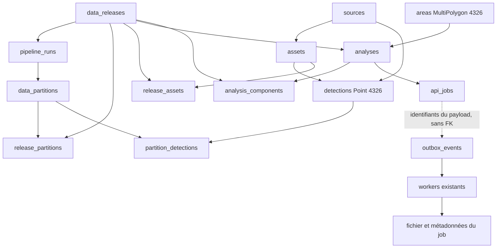

# Fixture Phase 4

> Historical report from the Phase 4 branch. For the merged implementation, current fixture v2, actual identity behavior and fresh validation, see [integration report](PHASE_4_REVIEW.md).

La fixture `phase4-rif-v1` est synthétique et isolée de la base historique.
L’audit autorisé l’a appliquée à `firebridge_phase4_test`. Son manifeste est
`.data/phase4-rif-v1/firebridge_phase4_test/manifest.json`. Les mesures de volume
utilisent `firebridge_integration_test`, une autre base conservée entre passages.

## Dépendances vérifiées



| Données minimales | Rôle et contraintes |
|---|---|
| Acteur `phase4-fixture:rif:v1` | Identité vérifiée par token de test ; propriétaire via api_jobs.requested_by. Aucune fausse ligne User n’est créée. |
| Source complète | Produit, fournisseur, stream standard, version, citation, licence, métadonnées synthétiques. Créée par le service source. |
| AOI | Rectangle longitude [-6.4,-3.6], latitude [34.8,35.9], version fixture, fuseau Africa/Casablanca. Polygon validé et normalisé en MultiPolygon 4326 par le service area. |
| Releases satellite | Une publiée compatible et une témoin non sélectionnée ; manifests/config/hash cohérents. Les politiques weather/reports autorisent leur absence : composants missing et analyse finale partial sont attendus. |
| Assets et runs | Deux assets liés à la source ; SHA-256, taille et provenance complets ; deux pipeline_runs avec clés uniques et FK releases. |
| Partitions et liens | Cinq partitions : principale, chevauchante, quarantaine, incomplète, autre release ; release_partitions, release_assets et partition_detections complets. |
| Détections | 264 Point 4326, timestamps UTC, source/asset, identité native/hash, niveau, confiance, jour/nuit et FRP cohérents. IDs bigint alloués par PostgreSQL. |
| Analyse + composants | Créés par analysesService, métrique native_detections_v1, UTC, sélection standard, sans grille, du 2026-08-01 au 2026-08-04 exclus. |
| Job et outbox | Créés atomiquement par les services d’analyse et d’export ; aucune insertion de job artificiellement succeeded. |

Le service garantit la définition de métrique requise. La FK metric_key déclarée
par Prisma n’est pas exprimée dans le SQL v2 inspecté ; le seed inspecte les
contraintes réelles et n’en invente aucune. Les fonctions PostGIS et le GiST sont
contrôlés avant insertion.

Il n’existe pas de service d’ingestion complet pour ces liens de provenance :
`ingestion.mjs` utilise donc du SQL paramétré avec tous les champs requis et
comparaison exacte des collisions. Source/AOI/analyse/exports passent par les
services métier. Toute collision différente provoque un arrêt, sans écrasement.

## Oracle spatial et exports

Quatre groupes de 64 points proches de Larache, Chefchaouen, Tétouan et
Al Hoceïma donnent **256 détections éligibles**, 128 day et 128 night, FRP total
1408. Il ne s’agit pas d’incendies observés.

| Tuile | Somme count attendue |
|---|---:|
| 0/0/0 | 256 |
| 8/123/101 | 64 |
| 8/124/100 | 64 |
| 8/124/101 | 64 |
| 8/125/101 | 64 |
| 8/0/0 | 0 |

Le manifeste détaille aussi les zooms 4, 12, 16 et 18. Le nombre de features MVT
peut être inférieur au nombre de détections : vérifier la somme de `count`.
Les propriétés MVT exposent le FRP maximum par groupe, pas le FRP total.

Huit témoins doivent être exclus : hors AOI, avant début, à la fin exclusive,
NRT, non lié à une partition, autre release, quarantaine et serving incomplet.
Une détection présente dans deux partitions ne doit apparaître qu’une fois.

Chaque export complet doit contenir exactement les mêmes 256 IDs, coordonnées,
dates, source, valeurs jour/nuit et FRP que le manifeste. Le CSV contient des
textes `=`, `+`, `-`, `@`, espaces initiaux, guillemets et retour à la ligne pour
tester neutralisation et parsing. GeoJSON/Parquet conservent les textes originaux.

## Reproductibilité et exécution

```powershell
# Aperçu pur : aucune connexion ni écriture
npm.cmd run seed:phase4
npm.cmd run audit:api -- --preview

# Workflow autorisé complet, sauvegarde et bases de test incluses
npm.cmd run audit:api
```

Pour une base de test déjà provisionnée, sans modifier le `.env` réel :

```powershell
$env:TEST_DATABASE_URL = 'postgresql://<utilisateur>:<mot-de-passe>@localhost:5432/firebridge_phase4_test?schema=firebridge'
$env:TEST_REDIS_URL = 'redis://localhost:6379/15'
npm.cmd run build
npm.cmd run seed:phase4 -- --apply --confirm-database firebridge_phase4_test
# Nécessite le worker de test en fonctionnement. Un label stable réutilise ses jobs.
npm.cmd run seed:phase4 -- --apply --confirm-database firebridge_phase4_test --queue-exports --export-run manuel_v1
```

Les noms de base doivent finir en `_test`, Redis utiliser 1–15, et les cibles
doivent différer de celles du développement. Les suffixes seuls ne prouvent pas
l’affectation de l’infrastructure : le lanceur complet provisionne les bases
locales depuis le schéma inspecté et utilise Redis 15 pour le smoke, 14 pour
l’intégration. Ne pas y lancer d’autres producteurs métier.

L’empreinte logique est
`89d0f21af494e90da34c53d308cef70b65b0503f222f41826fa0c1f42b929575`.
Les UUID d’ingestion dérivent du namespace ; les services et PostgreSQL allouent
leurs propres IDs physiques, conservés dans le manifeste et réutilisés dans la
même base. Le seed affiche created/reused/skipped, IDs, attentes et scope de
nettoyage. Une relance n’efface ni ne remplace les enregistrements existants.

Le résolveur de release publié est global dans l’architecture actuelle. Le seed
refuse une release publiée concurrente compatible plutôt que de la changer.
Une analyse reste queued jusqu’au worker ; attendre completed_at et ready/partial.

Les quotas restent actifs. Un nouveau lot d’exports utilise un nouveau label
après expiration ; une clé idempotente existante ne recrée pas un fichier expiré.
Plusieurs audits dans une heure consomment le quota réel de 10 exports/acteur.
Attendre sa fenêtre normale plutôt que modifier les dates ou supprimer des jobs.

## Conservation et nettoyage

Aucune commande de nettoyage SQL n’est fournie ou exécutée. Les bases de fixture,
d’intégration et de restauration vérifiée sont conservées. Les anciens fichiers
de backup restent présents dans `.data/audit` ; cette arborescence, les credentials
locaux et les exports téléchargés ne sont pas versionnés.

Le worker supprime normalement ses fichiers expirés et temporaires dans son
stockage dédié. Les tests d’erreur retirent uniquement leurs propres fichiers
temporaires. Pour arrêter seulement les conteneurs d’audit :

```powershell
$dockerExe = "$env:LOCALAPPDATA\Programs\DockerDesktop\resources\bin\docker.exe"
& $dockerExe stop firebridge-audit-api firebridge-audit-worker
```

Ne pas appliquer `docker-compose.test.yml` au projet initial : ce fichier sert
uniquement à construire les images pour cet audit.
